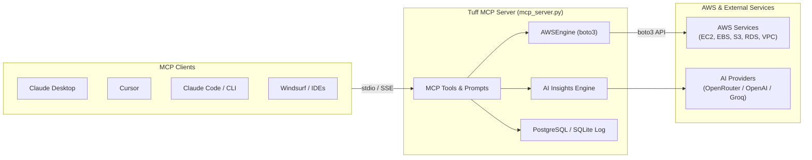

# Tuff Model Context Protocol (MCP) Server

The **Tuff MCP Server** connects AI development environments—such as Claude Desktop, Cursor, Claude Code, Antigravity, and Windsurf—directly to Tuff's Cloud Infrastructure Analysis Engine. It exposes tools for AWS cost optimization, security audits, root-cause diagnostics, and safe remediation via standard Model Context Protocol (MCP) transports.



---

## 🛠️ Tool Catalog

### 1. `tuff_audit_aws`
Performs a comprehensive cost and security audit across AWS resources in a given region.

* **Parameters:**
  * `region` *(string, default: `"us-east-1"`)*: Target AWS region (e.g., `us-east-1`, `eu-west-1`, `ap-south-1`).
  * `services` *(string, default: `"all"`)*: Service scope (`"all"`, `"ec2"`, `"ebs"`, `"s3"`, `"rds"`, `"vpc"`).
  * `include_global` *(boolean, default: `true`)*: Whether to inspect global resources (e.g., S3 buckets).
  * `explain_with_ai` *(boolean, default: `false`)*: Enriches high/critical findings with AI root-cause analysis if AI credentials are configured.
  * `aws_access_key` *(string, optional)*: Explicit AWS Access Key ID. Falls back to environment variables or ambient credentials.
  * `aws_secret_key` *(string, optional)*: Explicit AWS Secret Access Key. Falls back to environment variables or ambient credentials.
* **Returns:**
  ```json
  {
    "scan_id": "3fa85f64-5717-4562-b3fc-2c963f66afa6",
    "region": "us-east-1",
    "total_findings": 14,
    "estimated_monthly_savings_usd": 384.50,
    "estimated_annual_savings_usd": 4614.00,
    "severity_counts": { "critical": 2, "high": 3, "medium": 5, "low": 4 },
    "findings": [
      {
        "resource_id": "i-0123456789abcdef0",
        "resource_type": "ec2",
        "issue": "Idle EC2 instance (m5.xlarge)",
        "severity": "high",
        "estimated_monthly_savings": 140.16,
        "recommendation": "Stop or downsize idle instance",
        "action_type": "stop_instance"
      }
    ]
  }
  ```

---

### 2. `tuff_get_cost_waste_report`
Generates a targeted FinOps cost reduction report grouping wasteful spend by resource category.

* **Parameters:**
  * `region` *(string, default: `"us-east-1"`)*: AWS region to evaluate.
  * `aws_access_key` *(string, optional)*: Explicit AWS Access Key ID.
  * `aws_secret_key` *(string, optional)*: Explicit AWS Secret Access Key.
* **Returns:**
  ```json
  {
    "region": "us-east-1",
    "total_wasteful_resources": 8,
    "total_monthly_waste_usd": 512.40,
    "total_annual_waste_usd": 6148.80,
    "categories": {
      "ec2": { "count": 3, "monthly_savings": 320.00, "items": [...] },
      "ebs": { "count": 4, "monthly_savings": 112.40, "items": [...] },
      "rds": { "count": 1, "monthly_savings": 80.00, "items": [...] }
    },
    "top_waste_opportunities": [...]
  }
  ```

---

### 3. `tuff_get_security_risks`
Scans for cloud security vulnerabilities and misconfigurations.

* **Parameters:**
  * `region` *(string, default: `"us-east-1"`)*: AWS region to evaluate.
  * `aws_access_key` *(string, optional)*: Explicit AWS Access Key ID.
  * `aws_secret_key` *(string, optional)*: Explicit AWS Secret Access Key.
* **Returns:**
  ```json
  {
    "region": "us-east-1",
    "total_security_issues": 4,
    "critical_count": 1,
    "high_count": 2,
    "medium_count": 1,
    "critical_risks": [...],
    "high_risks": [...],
    "other_risks": [...]
  }
  ```

---

### 4. `tuff_explain_finding`
Generates root-cause analysis, business impact, security assessment, and exact AWS CLI remediation commands for a finding.

* **Parameters:**
  * `resource_id` *(string, required)*: AWS resource identifier (e.g., `i-0123456789abcdef0`, `production-data-bucket`).
  * `issue` *(string, required)*: Issue title (e.g., `"Public S3 Bucket"`).
  * `resource_type` *(string, required)*: Resource type (`"ec2"`, `"ebs"`, `"s3"`, `"rds"`, `"vpc"`).
  * `details` *(string, default: `""`)*: Diagnostic metrics or technical context.
  * `severity` *(string, default: `"medium"`)*: Severity level (`"critical"`, `"high"`, `"medium"`, `"low"`).
* **Returns:**
  ```json
  {
    "source": "tuff_ai_engine",
    "finding": { ... },
    "analysis": {
      "root_cause": "The S3 bucket lacks Public Access Block settings and has an unrestricted bucket policy.",
      "business_impact": "Exposure of sensitive customer data, regulatory penalties, and potential data leakage.",
      "security_risk": "Elevated",
      "remediation_guide": [
        "1. Verify whether public read access is required.",
        "2. Apply S3 Public Access Block immediately.",
        "3. Review bucket ACLs and policies for wildcard principals."
      ],
      "aws_cli_command": "aws s3api put-public-access-block --bucket my-bucket --public-access-block-configuration BlockPublicAcls=true,IgnorePublicAcls=true,BlockPublicPolicy=true,RestrictPublicBuckets=true"
    }
  }
  ```

---

### 5. `tuff_get_least_privilege_iam_policy`
Returns the official AWS IAM policy JSON required for Tuff to safely inspect or remediate infrastructure.

* **Parameters:**
  * `include_remediation` *(boolean, default: `false`)*: When `false`, returns read-only audit permissions. When `true`, includes safe remediation actions (`StopInstances`, `DeleteVolume`, `PutBucketPublicAccessBlock`, etc.).
* **Returns:**
  ```json
  {
    "type": "read_only",
    "policy_json": {
      "Version": "2012-10-17",
      "Statement": [ ... ]
    }
  }
  ```

---

### 6. `tuff_get_scan_history`
Retrieves past audit records and summaries from the Tuff persistence layer.

* **Parameters:**
  * `limit` *(integer, default: `5`)*: Maximum number of historical records to return.
* **Returns:**
  ```json
  [
    {
      "scan_id": "3fa85f64-5717-4562-b3fc-2c963f66afa6",
      "region": "us-east-1",
      "timestamp": "2026-11-10T12:00:00Z",
      "findings_count": 14,
      "status": "completed",
      "error_message": null
    }
  ]
  ```

---

### 7. `tuff_remediate_resource`
Executes or simulates automated remediation actions on flagged resources.

> [!CAUTION]
> Always run with `dry_run=true` (the default) first. Set `dry_run=false` only after reviewing the pre-flight check and obtaining explicit confirmation.

* **Supported Actions:**
  * `stop_instance`: Stops an idle EC2 instance.
  * `delete_instance`: Terminates an abandoned EC2 instance.
  * `delete_volume`: Deletes an unattached EBS volume.
  * `delete_vpc`: Safely deletes an empty VPC and disassociates dangling gateways.
  * `stop_rds`: Stops an idle RDS instance.
  * `secure_s3`: Enables S3 Public Access Block on a public bucket.
  * `scale_instance`: Rightsizes an over-provisioned EC2 instance to `target_type` (default: `t3.micro`).
* **Parameters:**
  * `resource_id` *(string, required)*: Target resource ID.
  * `action_type` *(string, required)*: Action name from the list above.
  * `region` *(string, default: `"us-east-1"`)*: Resource AWS region.
  * `dry_run` *(boolean, default: `true`)*: When `true`, validates pre-conditions without changing resource state.
  * `target_type` *(string, default: `"t3.micro"`)*: Target instance type when resizing via `scale_instance`.
  * `aws_access_key` *(string, optional)*: Explicit AWS Access Key ID.
  * `aws_secret_key` *(string, optional)*: Explicit AWS Secret Access Key.
* **Returns:**
  ```json
  {
    "dry_run": true,
    "status": "validated",
    "message": "Pre-flight check passed for stop_instance on i-0123456789abcdef0. No changes were made.",
    "action_type": "stop_instance",
    "resource_id": "i-0123456789abcdef0",
    "region": "us-east-1"
  }
  ```

---

## 📋 Prompts & Resources

### Prompts
* `audit_cloud_costs(region="us-east-1")`: Predefined prompt workflow that runs `tuff_get_cost_waste_report`, aggregates wasted spend, and lists step-by-step savings opportunities.
* `audit_security_hardening(region="us-east-1")`: Predefined prompt workflow that triggers `tuff_get_security_risks` to surface exposed buckets, unprotected VPCs, and remediation steps.

### Resources
* `tuff://policies/read-only-iam`: Direct access to the official AWS IAM policy JSON document for read-only audits.

---

## 🔑 AWS Credential Resolution

Tuff resolves AWS credentials in the following order:
1. **Tool Arguments:** Explicit `aws_access_key` and `aws_secret_key` passed to tool calls.
2. **Environment Variables:** `AWS_ACCESS_KEY_ID`, `AWS_SECRET_ACCESS_KEY`, and `AWS_DEFAULT_REGION` / `AWS_REGION`.
3. **Ambient AWS Credentials:** Active IAM role (EC2/ECS/Lambda), AWS SSO session, or standard credentials in `~/.aws/credentials` configured via `aws configure`.

> [!TIP]
> If your workstation is already configured with the AWS CLI (`~/.aws/credentials`) or AWS SSO, you do not need to include AWS access keys in your MCP client JSON configuration.

---

## ⚙️ Client Configuration Guides

### 1. Claude Desktop

Add Tuff to your `claude_desktop_config.json`:
* **Windows:** `%APPDATA%\Claude\claude_desktop_config.json`
* **macOS:** `~/Library/Application Support/Claude/claude_desktop_config.json`

#### Windows Configuration
```json
{
  "mcpServers": {
    "tuff": {
      "command": "D:/Projects/Github/Tuff/backend/.venv/Scripts/python.exe",
      "args": [
        "D:/Projects/Github/Tuff/backend/mcp_server.py"
      ],
      "env": {
        "AWS_DEFAULT_REGION": "us-east-1"
      }
    }
  }
}
```

#### macOS / Linux Configuration
```json
{
  "mcpServers": {
    "tuff": {
      "command": "/absolute/path/to/Tuff/backend/.venv/bin/python",
      "args": [
        "/absolute/path/to/Tuff/backend/mcp_server.py"
      ],
      "env": {
        "AWS_DEFAULT_REGION": "us-east-1"
      }
    }
  }
}
```

---

### 2. Cursor IDE

#### Option A: Project Configuration (`.cursor/mcp.json`)
Create `.cursor/mcp.json` in your repository root:
```json
{
  "mcpServers": {
    "tuff": {
      "command": "D:/Projects/Github/Tuff/backend/.venv/Scripts/python.exe",
      "args": [
        "D:/Projects/Github/Tuff/backend/mcp_server.py"
      ],
      "env": {
        "AWS_DEFAULT_REGION": "us-east-1"
      }
    }
  }
}
```

#### Option B: Global Settings
1. Open **Settings** $\rightarrow$ **Features** $\rightarrow$ **MCP**.
2. Click **+ Add New MCP Server**.
3. Set **Type** to `command`.
4. Enter the command path to Python and `mcp_server.py`.

---

### 3. Claude Code CLI

Add the Tuff MCP server using the `claude mcp` CLI command:
```bash
claude mcp add tuff -- D:/Projects/Github/Tuff/backend/.venv/Scripts/python.exe D:/Projects/Github/Tuff/backend/mcp_server.py
```

---

### 4. Windsurf

Add Tuff to `~/.codeium/windsurf/mcp_config.json`:
```json
{
  "mcpServers": {
    "tuff": {
      "command": "D:/Projects/Github/Tuff/backend/.venv/Scripts/python.exe",
      "args": [
        "D:/Projects/Github/Tuff/backend/mcp_server.py"
      ],
      "env": {
        "AWS_DEFAULT_REGION": "us-east-1"
      }
    }
  }
}
```

---

## 🌐 Remote / Hosted SSE Mode

To run Tuff as a standalone HTTP/SSE service for remote AI agents:

```bash
cd backend
python mcp_server.py --transport sse --port 8001
```

### SSE Connection Verification
The server exposes an SSE endpoint on port 8001.

**Minimal runnable cURL check:**
```bash
curl -N -H "Accept: text/event-stream" http://localhost:8001/sse
```

Expected response stream:
```text
event: endpoint
data: /messages?session_id=...
```

---

## 🔍 Verification with MCP Inspector

You can test and inspect all Tuff MCP tools interactively without opening Claude Desktop using the official MCP Inspector:

```bash
npx @modelcontextprotocol/inspector D:/Projects/Github/Tuff/backend/.venv/Scripts/python.exe D:/Projects/Github/Tuff/backend/mcp_server.py
```

---

## 🔒 Security & Safety Controls

1. **Read-Only by Default:** Tools `tuff_audit_aws`, `tuff_get_cost_waste_report`, `tuff_get_security_risks`, `tuff_explain_finding`, and `tuff_get_least_privilege_iam_policy` issue read-only AWS API calls (`Describe*`, `Get*`, `List*`).
2. **Mandatory Dry Run Guard:** `tuff_remediate_resource` defaults to `dry_run=true`. It asserts resource existence and valid transition states before modifying anything.
3. **Execution Logging:** All live remediation actions write audit trails to the database with action type, resource ID, outcome message, and timestamp.
4. **Least-Privilege IAM:** Run `tuff_get_least_privilege_iam_policy(include_remediation=false)` to generate the exact IAM policy required for read-only audits.
